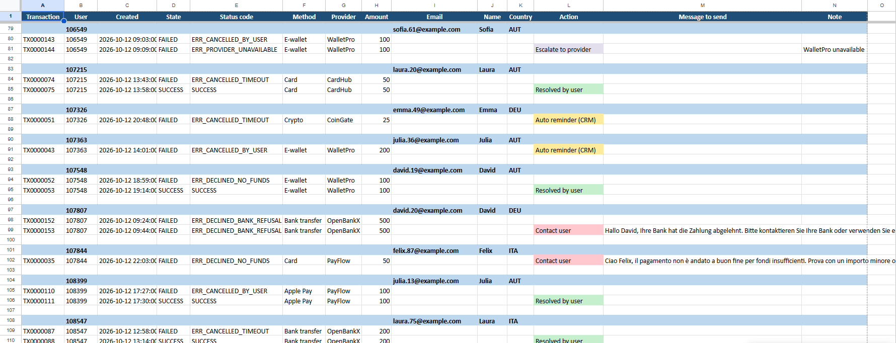
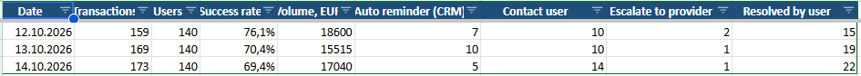
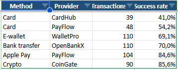
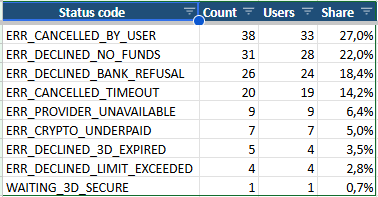

# Payment Follow-up — failed payments report for support teams

Turns a raw transaction export from a payment back office into a ready-to-work report: who had failed deposits, who already resolved the problem on their own, who needs a message (with a ready text in their language) and which cases are the provider's fault.

Built from real experience in L2 Payment Support — this is the daily routine of a payments team, automated. All data in this repo is **synthetic**.


## 🎯 The problem

A support agent gets a back-office export with hundreds of transactions in random order. By hand they have to group attempts by user, figure out whether the user eventually paid, pick the right reply for the error code, translate it — every single day.

## ✨ What it does

- 🧹 **Cleans the export** — removes duplicates, normalizes status codes, sorts attempts in time order
- 🗂 **Groups by day → user → attempts** (users with only successful payments are skipped)
- 🧠 **Decides the action for every user:**

| Action | When |
|---|---|
| ✅ **Resolved by user** | had a failure, but the last attempt succeeded — no need to contact |
| ✉️ **Contact user** | hard decline (no funds, bank refusal, 3DS expired, limit, crypto underpaid) — a ready message is generated |
| 🔔 **Auto reminder (CRM)** | soft failure (cancelled by user, timeout, pending 3DS) — an automatic reminder is enough |
| 🛠 **Escalate to provider** | provider unavailable — not the user's fault |

- 🌍 **Messages in the user's language** — templates per error code (EN / DE / IT), name substituted automatically
- ⚠️ **Flags repeated failures** — 3+ failed attempts in a day
- 📊 **Analytics sheets:**
  - **Daily** — transactions, success rate, volume, actions per day
  - **Providers** — success rate by payment method and provider (spots a provider with poor conversion for traffic routing)
  - **Errors** — top decline reasons and their share

## 📸 Screenshots

**Follow-up sheet** — day → user → attempts, color-coded actions and ready messages in the user's language



**Daily** — success rate, volume and actions per day



| **Providers** — conversion by method and provider (CardHub clearly underperforms) | **Errors** — top decline reasons |
|---|---|
|  |  |

## 🧱 Project structure

```
main.py             — entry point: export → report
followup.py         — loading, cleaning, grouping, analytics (pandas)
rules.py            — business rules and message templates
report.py           — formatted Excel report (openpyxl)
generate_sample.py  — generates a synthetic back-office export
```

## 🚀 Run

```bash
python -m venv .venv
.venv\Scripts\activate
pip install -r requirements.txt

python generate_sample.py           # create a synthetic export in input/
python main.py                      # → output/followup_<date>.xlsx
python main.py path/to/export.csv   # process your own export
```

Expected CSV columns: `id, user_id, created, state, status_code, method, provider, amount, currency, email, first_name, country`.

## 🔄 Adapting

Business logic lives in [`rules.py`](rules.py): which codes are "soft", which are the provider's fault, message templates and languages. Column names of a different back office are mapped in one place in `followup.py`. The same approach also works as a **Google Apps Script** inside Google Sheets.

---

## 🇷🇺 Кратко по-русски

Обработка выгрузки транзакций из бэк-офиса платёжной системы: группирует попытки по дню и пользователю, определяет, кто решил проблему сам (Resolved by user), кому написать (с готовым текстом на языке пользователя), кому хватит автоматического напоминания, а где виноват провайдер. Плюс аналитика: конверсия по провайдерам и методам, топ ошибок, сводка по дням.

**Нужно автоматизировать отчёты или выгрузки?** Пишите — [GitHub @ARTmin05](https://github.com/ARTmin05).
